  

  

I design and build privacy-first AI platforms, multi-tenant SaaS products, and real-time industrial IoT solutions. 
My work sits where enterprise operational data meets conversational intelligence.

<h2 align="center">About</h2>

<table align="center">
  <tr>
    <td><b>Role</b></td>
    <td>Implementation Engineer at Dynamic Smart Edge</td>
  </tr>
  <tr>
    <td><b>Specialization</b></td>
    <td>Conversational &amp; Reasoning AI with LangChain and LangGraph</td>
  </tr>
  <tr>
    <td><b>Flagship Work</b></td>
    <td>Sole architect of a privacy-first, multi-tenant SaaS AI platform for large industrial enterprises</td>
  </tr>
  <tr>
    <td><b>Industrial IoT</b></td>
    <td>N3uron deployments with OPC UA, MQTT, Modbus and REST integrations</td>
  </tr>
  <tr>
    <td><b>Experience</b></td>
    <td>Deep Learning, NLP, Computer Vision and Generative AI</td>
  </tr>
  <tr>
    <td><b>Education</b></td>
    <td>MCA, Lovely Professional University (CGPA 8.09)</td>
  </tr>
</table>

<h2 align="center">Focus &amp; Learning</h2>

<table align="center">
  <tr>
    <th align="left" width="50%">Current Focus</th>
    <th align="left" width="50%">Currently Learning</th>
  </tr>
  <tr>
    <td valign="top">
      <ul>
        <li>Conversational AI over enterprise operational data</li>
        <li>LLM and RAG systems (OpenAI and Anthropic APIs)</li>
        <li>Multi-agent reasoning workflows with LangGraph</li>
        <li>Industrial IoT: real-time dashboards, historian, redundancy</li>
        <li>Secure multi-tenant SaaS architecture (RBAC, audit logging)</li>
      </ul>
    </td>
    <td valign="top">
      <ul>
        <li>Agentic AI: multi-agent workflows, tool calling and planning</li>
        <li>Model Context Protocol (MCP)</li>
        <li>AWS: EC2, S3, Lambda, IAM, RDS and Amazon Bedrock</li>
        <li>LLM Evaluation and Observability</li>
        <li>Vector Databases and Advanced RAG</li>
        <li>Docker and CI/CD Pipelines</li>
        <li>Scalable System Design</li>
      </ul>
    </td>
  </tr>
</table>

<h2 align="center">Tech Stack</h2>

<table align="center">
  <tr>
    <td><b>Languages</b></td>
    <td>
      
      
    </td>
  </tr>
  <tr>
    <td><b>AI / ML</b></td>
    <td>
      
      
      
      
      
      
      
      
    </td>
  </tr>
  <tr>
    <td><b>Backend</b></td>
    <td>
      
      
      
      
    </td>
  </tr>
  <tr>
    <td><b>Frontend</b></td>
    <td>
      
    </td>
  </tr>
  <tr>
    <td><b>Databases</b></td>
    <td>
      
      
      
      
    </td>
  </tr>
  <tr>
    <td><b>Industrial IoT</b></td>
    <td>
      
      
      
      
      
      
    </td>
  </tr>
  <tr>
    <td><b>Security &amp; Architecture</b></td>
    <td>
      
      
      
      
      
    </td>
  </tr>
</table>

<h2 align="center">Featured Projects</h2>

<table>
  <tr>
    <td width="30%" valign="top">
      <b>Conversational &amp; Reasoning AI Platform</b> 
      Multi-tenant enterprise SaaS  
      Python · LangChain · LangGraph · Next.js · MSSQL · MongoDB · OpenAI API · Anthropic API
    </td>
    <td valign="top">
      <ul>
        <li>Privacy-first platform that lets large industrial firms extract insights from operational data through conversational queries, with zero raw data exposure to AI training pipelines</li>
        <li>Supports <b>3 database types</b>: PostgreSQL, MSSQL and MongoDB</li>
        <li>Query engine with <b>5+ output types</b>: tables, dynamic charts, anomaly detection, key insights and follow-up questions</li>
        <li><b>3-tier RBAC</b> (Super Admin, Tenant Admin, Tenant User) with tenant isolation, bcrypt authentication, audit logging and white-labeling</li>
        <li>Super-admin controls: tenant blocking, user management, per-tenant API keys, token usage tracking and strictly read-only database access</li>
      </ul>
    </td>
  </tr>
  <tr>
    <td width="30%" valign="top">
      <b>Industrial IoT Deployment</b> 
      Pharmaceutical plant  
      N3uron · OPC UA · MQTT · Modbus · REST APIs
    </td>
    <td valign="top">
      <ul>
        <li>Connected <b>10+ plant-floor machines</b> for real-time data acquisition, monitoring and edge computing</li>
        <li>Integrated <b>4 industrial protocols</b> to enable communication between machines and enterprise systems</li>
        <li>Delivered real-time dashboards for production monitoring, redundancy management and historian use cases</li>
      </ul>
    </td>
  </tr>
  <tr>
    <td width="30%" valign="top">
      <b>Skin Disease Classification</b> 
      Vision Transformer  
      PyTorch · torchvision · OpenCV · matplotlib
    </td>
    <td valign="top">
      <ul>
        <li>Fine-tuned an ImageNet-pretrained Vision Transformer to classify acne, redness and under-eye bags</li>
        <li>Achieved <b>92.86% test accuracy</b> on a multi-class dataset</li>
        <li>Applied preprocessing, augmentation and stratified splitting to improve robustness</li>
      </ul>
    </td>
  </tr>
</table>

<h2 align="center">Certifications</h2>

<table align="center">
  <tr>
    <th align="left">Certification</th>
    <th align="left">Issuer</th>
    <th align="left">Date</th>
  </tr>
  <tr><td>N3uron 1.22 Certified Integrator</td><td>N3uron</td><td>Jul 2026</td></tr>
  <tr><td>Claude 101</td><td>Anthropic</td><td>Oct 2025</td></tr>
  <tr><td>Claude Code 101</td><td>Anthropic</td><td>Oct 2025</td></tr>
  <tr><td>Advanced Python for ML &amp; AI</td><td>CSE Pathshala</td><td>Jul 2024</td></tr>
</table>

<h2 align="center">GitHub Activity</h2>

 

<h2 align="center">What I Enjoy</h2>

  Conversational AI &amp; LLM Applications &nbsp;·&nbsp; Secure SaaS Architecture &nbsp;·&nbsp; Industrial IoT &amp; Edge Computing 
  Data Analysis &amp; Insight Engines &nbsp;·&nbsp; Computer Vision &amp; Deep Learning &nbsp;·&nbsp; Production-Grade Intelligent Systems

 

<i>"The best interface to any system is a conversation."</i>

 

